# Tomba! 2: The Evil Swine Return — Modern Bevy (Rust) Port

> **Objetivo del Proyecto:** Port nativo moderno y reimplementación completa del clásico de PlayStation 1 **Tomba! 2: The Evil Swine Return** en **Rust**, utilizando el motor de videojuegos basado en ECS **[Bevy](https://bevyengine.org/)**.

---

## ⚠️ AVISO PARA DESARROLLADORES Y AGENTES IA

> [!IMPORTANT]
> **ESTE PROYECTO YA NO ES UNA DESCOMPILACIÓN BYTE-MATCHING PARA PS1, PERO TAMPOCO ES UN "TOMBALIKE" INVENTADO.**
> - **NO** intentes compilar código C con compiladores antiguos de PS1 (`cc1`, PsyQ, `maspsx`).
> - **NO** intentes hacer diffs de ensamblador MIPS (`asm-differ`, `splat`).
> - **NO EMULAR HARDWARE DE PS1, SINO REIMPLEMENTAR LA LÓGICA EXACTA DE JUEGO:** El objetivo es portar la lógica matemática, cinemática y de estados del juego a un motor moderno (Bevy), **NO emular las limitaciones ni la cadencia de reloj de la PS1**. Queda prohibido forzar VBlanks artificiales, bucles discretos a 30 Hz con ticks fijos o emulación de hardware de bajo nivel que causan stuttering/vibraciones en monitores modernos de 60Hz / 144Hz. Las fórmulas cinemáticas originales (velocidades, aceleraciones de subida `0x360` y bajada `0x400`, umbrales y alturas de ápice) deben integrarse suavemente con el `dt` real del motor, garantizando una respuesta fluida a 60+ FPS exactamente con la parábola y el diseño del juego original.
- **NO INVENTAR LÓGICA DE JUEGO ("Vibe-coding" / Heurísticas ad-hoc):** Queda estrictamente prohibido inventar constantes mágicas, tolerancias arbitrarias, offsets visuales ("lo veo bajo y le sumo 30px") o físicas genéricas. Esto no es un clon genérico con skins de Tomba, es la **reimplementación fiel del juego original**.
> - **TOMBA2EDIT ES UN EXTRACTOR DE ASSETS, NUNCA FUENTE DE VERDAD PARA LA LÓGICA:** `Tomba2Edit` es una herramienta excelente para inspeccionar y exportar assets (mallas `SMST`, animaciones `ANMP`, colisiones `SCLD`, texturas y audio), pero **JAMÁS debe utilizarse para justificar o inventar lógica de juego**. Si un asset extraído presenta cierta dimensión, hueso o propiedad geométrica, **NO se debe inventar una fórmula matemática en el motor en función de ese asset**. El extractor sirve para entender cómo están compuestos los datos originales; la lógica en tiempo de ejecución proviene **exclusivamente del código fuente (`Tomba2Engine/` y `src/`)** y debe comportarse de forma **estrictamente equivalente al juego original**.
> - **CORRELACIÓN DIRECTA Y DOCUMENTADA OBLIGATORIA:** Toda la lógica de físicas, movimiento, resolución de colisiones, snapping de suelos, control de cámara, estados y transiciones debe tener **correlación directa 1:1 con el código de `Tomba2Engine` y los dumps de `src/`**, portada a la arquitectura ECS de Bevy y **comentada con su origen exacto** (archivo, función o dirección).
> - **LIBERTAD TOTAL EN CONVERSIÓN DE ASSETS:** En la extracción y conversión offline de assets (modelos, texturas, sonidos, animaciones, mallas de nivel y colisiones a glTF 2.0 / JSON / WAV), adapta, moderniza y utiliza las herramientas necesarias, preservando siempre la equivalencia visual y espacial con el juego.
> - **RESOLUCIÓN DE BUGS:** Ante cualquier comportamiento anómalo o bug, la solución **NUNCA** es parchar con números a ojo ni ajustar fórmulas según cómo se ve la malla exportada; es ir al código original (`Tomba2Engine/` y `src/`) a investigar la matemática y el diseño original que lo resuelve.

---

## 🏛️ Los Tres Pilares del Proyecto

Para lograr este port sin reinventar la rueda ni depender de ingeniería inversa desde cero, contamos con tres fuentes clave:

```mermaid
flowchart TD
    subgraph A["1. Pipeline de Assets"]
        T2Edit["Tomba2Edit (Python)"]
        T2Edit -->|Exporta| GLB["Modelos 3D y Niveles (.glb)"]
        T2Edit -->|Exporta| PNG["Texturas y Sprites (.png)"]
        T2Edit -->|Exporta| AUDIO["Audio y SFX (.wav)"]
        T2Edit -->|Exporta| JSON["Textos y Diálogos (.json)"]
    end

    subgraph B["2. Arquitectura y Lógica"]
        T2Eng["Tomba2Engine (C++)"]
        T2Eng -->|Referencia| MOV["Físicas y Movimiento (actor_tomba.cpp)"]
        T2Eng -->|Referencia| CAM["Cámara en Rieles (cutscene_camera.cpp)"]
        T2Eng -->|Referencia| COL["Colisión y Contacto (collision_resolve.cpp)"]
        T2Eng -->|Referencia| EVT["Eventos y Flags (scene_flags)"]
    end

    subgraph C["3. Ground Truth & Dumps"]
        GHIDRA["src/ (Ghidra Dumps)"]
        GHIDRA -->|Consulta| OV["Overlays A00-A0L (~15k líneas C)"]
        GHIDRA -->|Consulta| MAIN["MAIN.EXE Dumps (~56k líneas C)"]
        GHIDRA -->|Estructuras| INC["include/tomba.h y symbol_addrs.txt"]
    end

    GLB & PNG & AUDIO & JSON --> BEVY["bevy_tomba2 (Port en Rust / Bevy)"]
    MOV & CAM & COL & EVT --> BEVY
    OV & MAIN & INC --> BEVY
```



1. **Extractor de Assets (`Tomba2Edit/`)**:
   - Repositorio activo en Python/PyQt6 capaz de leer la ISO/BIN del juego.
   - Extrae modelos 3D (`SMST`), escenarios (`MDAT`) y animaciones (`ANMP`) directamente a **glTF 2.0 / GLB** con texturas y esqueletos compatibles de forma nativa con Bevy.
   - Extrae sprites (`SPRT`), audio (`WAV`/`MIDI`), diálogos (`JSON`) y planos de colisión (`SCLD`).
   - **Límite de responsabilidad:** Es una herramienta de extracción offline. No debe utilizarse para derivar fórmulas o lógicas en tiempo de ejecución. Permite comprender el formato binario original, pero la lógica debe ser equivalente a la del código fuente de `MAIN.EXE`.

2. **Lógica y Arquitectura en C++ (`Tomba2Engine/`)**:
   - Proyecto de ingeniería inversa avanzada con ~73.000 líneas de C++ estructurado y documentado.
   - Contiene la traducción limpia del control del jugador ([`actor_tomba.cpp`](Tomba2Engine/game/player/actor_tomba.cpp)), la cámara tridimensional sobre rieles ([`cutscene_camera.cpp`](Tomba2Engine/game/camera/cutscene_camera.cpp)), la resolución de colisiones y las tablas de eventos.
   - **Es la plantilla directa para diseñar los componentes y sistemas en Bevy.**

3. **Base de Datos de Descompilación y Estructuras (`src/` e `include/`)**:
   - Contiene los volcados completos de Ghidra en lenguaje C (`src/main/` con ~56k líneas y `src/overlays/` con ~15k líneas correspondientes a las zonas `A00` a `A0L`).
   - Sirve como oráculo de consulta cuando se necesite implementar minijuegos, jefes específicos de un overlay o verificar offsets de memoria en [`include/tomba.h`](include/tomba.h) y [`symbol_addrs.txt`](symbol_addrs.txt).

---

---

## 📋 Control de Implementación y Kanban Maestro (1.567 Funciones)

El avance del proyecto no se gestiona mediante listas de fases pasivas o estimaciones abstractas, sino como una **implementación total 1:1 contra el código fuente original (`Tomba2Engine/`, `MAIN.EXE` y overlays `src/`)**.

El juego completo está catalogado en un censo técnico exhaustivo de **1.567 funciones y máquinas de estado** en **33 categorías técnicas**, estructuradas en **12 Sectores Maestros**:

| Sector | Código | Subsistema del Motor | Funciones Reales | Estado en Bevy |
| :--- | :---: | :--- | :---: | :---: |
| **SEC-01** | `ACT` | **Player & Entity Action State Machines** (Locomoción, Salto, Dash, Vuelo, Nado, Escalada, Ataque, Lanzamiento, Daño) | 64 | **64 / 64** (100%) |
| **SEC-02** | `PHY` | **Entity Physics & Kinematics** (Velocidades, Gravedades de subida/bajada, Inercia, Pendientes, Contacto) | 82 | **82 / 82** (100%) |
| **SEC-03** | `COL` | **2.5D Collision & SCLD Rail Grid** (Proyección ortogonal, Sondeo de suelo, Paredes, Bifurcaciones) | 35 | **35 / 35** (100%) |
| **SEC-04** | `ENT` | **Entity Allocation, Lifecycle & Loops** (Pools 0..5, Listas enlazadas, Bucles de tick, Spawning de hijos) | 357 | **4 / 357** |
| **SEC-05** | `BEH` | **Entity Behaviors, AI & Interactive World** (Cerdos Koma, Jefes, NPCs, Puertas, Mecanismos, Proyectiles) | 71 | **1 / 71** |
| **SEC-06** | `ANM` | **Skeletal Animation VM & Sprites** (239 clips ANMP, Jerarquía de huesos, Sprites 3D, Partículas) | 81 | **2 / 81** |
| **SEC-07** | `CAM` | **2.5D Rail Camera Pipeline** (Filtro por ejes, Deadzone vertical, Pisos de área, Matriz de vista 1:1) | 32 | **8 / 32** |
| **SEC-08** | `ITM` | **Items, Inventory & Equipment** (Menú 32 casos, Armas, Trajes Ardilla/Pájaro/Cerdo, 99 slots) | 8 | **0 / 8** |
| **SEC-09** | `EVT` | **Event Engine & Script Interpreter** (256 flags maestros, 137 misiones, Intérprete de bytecode de escena) | 49 | **0 / 49** |
| **SEC-10** | `UI` | **UI, Dialog System & HUD** (Paneles 9-slice, Flujo tipográfico, Métricas de fuente, HUD vitalidad/AP) | 88 | **0 / 88** |
| **SEC-11** | `AUD` | **Audio System & Sound Dispatch** (Música CD-XA, Atenuación en diálogo, Sintetizador SPU, SFX) | 140 | **2 / 140** |
| **SEC-12** | `SYS` | **Memory Card, GPU, CD & Low-Level Subsystems** (Guardado MC, Paquetes GPU, GTE, Streaming CD, MDEC) | 560 | **1 / 560** |
| **TOTAL** | — | **Todas las 33 categorías de MAIN.EXE** | **1.567** | **201 implementadas** |

👉 **El inventario individualizado fila por fila** con cada una de las 1.567 funciones, direcciones de memoria PS1 (`0x800...`), archivos fuente, comportamientos técnicos y mapeo ECS vive en:

👉 **[Kanban e Inventario Técnico de Implementación Maestro (KANBAN.md)](KANBAN.md)**

Cualquier cambio, nueva funcionalidad o corrección en `bevy_tomba2/` debe reflejarse y actualizarse directamente en dicho inventario con su estado (`[x]`, `[ ]`) y su correspondiente referencia técnica al código fuente original (`Tomba2Engine/` y `src/`).

---

## 📂 Organización de Archivos

```
revert-tomba2/
├── Tomba2Edit/           # Toolkit Python: extracción de assets, visor y editor
├── Tomba2Engine/         # Motor C++: referencia arquitectónica y lógica matemática
├── src/                  # Dumps descompilados de Ghidra en C (MAIN.EXE y Overlays A00-A0L)
├── include/              # Encabezados con structs de entidades (tomba.h)
├── symbol_addrs.txt      # Mapeo maestro de direcciones de memoria a nombres legibles
├── tools/                # Scripts auxiliares y herramientas de mapeo
│   └── map_functions.py  # Diccionario maestro de funciones identificadas (>2000 líneas)
├── bevy_tomba2/          # (Próximo) Proyecto nativo en Rust con Bevy
└── README.md             # Esta guía y hoja de ruta
```

---

## 🛠️ Reglas para Contribuir

1. **Escribe en Rust idiomático:** Utiliza la arquitectura de Bevy (`Component`, `Resource`, `System`, `Query`, `Event`).
2. **Jerarquía Estricta de Fuentes de Verdad:**
   - **Prioridad 1 (Principal Fuente de Verdad): `Tomba2Engine/`**. Toda la investigación de física, movilidad de Tomba, detección de suelo, colisiones, máquinas de estado, cámaras y matemáticas debe buscarse **primero y obligatoriamente** en `Tomba2Engine/` (`Tomba2Engine/game/`, `Tomba2Engine/game/player/`, etc.).
   - **Prioridad 2 (Fallback Secundario): `src/` y Dumps de Ghidra**. Los archivos de `src/` contienen descompilaciones preliminares y funciones renombradas manualmente; deben consultarse **únicamente como respaldo secundario** si un detalle u offset específico no se encuentra documentado en `Tomba2Engine/`.
   - **Prohibido como fuente de lógica: `Tomba2Edit`**. Es estrictamente un extractor/conversor de assets offline. Jamás se debe deducir o inventar una fórmula de juego basándose en la estructura de un asset o en el código de Python de `Tomba2Edit`.
3. **Cero Lógica Inventada / Cero Vibe-Coding:** Cada constante, ecuación, umbral de detección, física de salto, gravedad, offset de cámara y comprobación de estado debe provenir del código original y estar **comentada con su origen** (`// Referencia: ActorTomba::velocityIntegrate 0x80056B48`).
4. **Trata los Bugs con Ingeniería Inversa:** Si un comportamiento en Bevy no coincide con el juego original, no apliques parches cosméticos ni números ad-hoc; investiga en el código descompilado cómo gestiona el juego original ese caso específico.
5. **Los Assets no dictan la Lógica:** No utilices `Tomba2Edit` ni las características de los assets exportados para inventar o inferir mecánicas, offsets de contacto o fórmulas en el juego. `Tomba2Edit` aporta el entendimiento del formato de datos, pero la lógica procede estrictamente de `Tomba2Engine` (y fallback `src/`).
6. **No ensucies el repositorio con binarios de MIPS:** Los assets deben procesarse y almacenarse en formatos modernos (`.glb`, `.png`, `.wav`, `.json`).
7. **Lógica Matemática del Juego vs. Emulación de Hardware:** Reimplementamos la física, la cinemática y la lógica de juego de Tomba 2, **NO un emulador de PlayStation 1**. Queda prohibido forzar ciclos de reloj de PS1, acumuladores discretos a 30 Hz o bloqueos de fotogramas que degraden el refresco en pantallas modernas (60Hz / 144Hz). Las fórmulas se integran de forma continua con `dt` conservando fielmente las aceleraciones, velocidades y umbrales de `Tomba2Engine/` para una experiencia nativa y fluida.
