# Tomba! 2: The Evil Swine Return — Modern Bevy (Rust) Port

> **Objetivo del Proyecto:** Port nativo moderno y reimplementación completa del clásico de PlayStation 1 **Tomba! 2: The Evil Swine Return** en **Rust**, utilizando el motor de videojuegos basado en ECS **[Bevy](https://bevyengine.org/)**.

---

## ⚠️ AVISO PARA DESARROLLADORES Y AGENTES IA

> [!IMPORTANT]
> **ESTE PROYECTO YA NO ES UNA DESCOMPILACIÓN BYTE-MATCHING PARA PS1, PERO TAMPOCO ES UN "TOMBALIKE" INVENTADO.**
> - **NO** intentes compilar código C con compiladores antiguos de PS1 (`cc1`, PsyQ, `maspsx`).
> - **NO** intentes hacer diffs de ensamblador MIPS (`asm-differ`, `splat`).
> - **NO INVENTAR LÓGICA DE JUEGO ("Vibe-coding" / Heurísticas ad-hoc):** Queda estrictamente prohibido inventar constantes mágicas, tolerancias arbitrarias, offsets visuales ("lo veo bajo y le sumo 30px") o físicas genéricas. Esto no es un clon genérico con skins de Tomba, es la **reimplementación fiel del juego original**.
> - **TOMBA2EDIT ES UN EXTRACTOR DE ASSETS, NUNCA FUENTE DE VERDAD PARA LA LÓGICA:** `Tomba2Edit` es una herramienta excelente para inspeccionar y exportar assets (mallas `SMST`, animaciones `ANMP`, colisiones `SCLD`, texturas y audio), pero **JAMÁS debe utilizarse para justificar o inventar lógica de juego**. Si un asset extraído presenta cierta dimensión, hueso o propiedad geométrica, **NO se debe inventar una fórmula matemática en el motor en función de ese asset**. El extractor sirve para entender cómo están compuestos los datos originales; la lógica en tiempo de ejecución proviene **exclusivamente del código fuente (`Tomba2Engine/` y `src/`)** y debe comportarse de forma **estrictamente equivalente al juego original**.
> - **CORRELACIÓN DIRECTA Y DOCUMENTADA OBLIGATORIA:** Toda la lógica de físicas, movimiento, resolución de colisiones, snapping de suelos, control de cámara, estados y transiciones debe tener **correlación directa 1:1 con el código de `Tomba2Engine` y los dumps de `src/`**, portada a la arquitectura ECS de Bevy y **comentada con su origen exacto** (archivo, función o dirección).
> - **LIBERTAD TOTAL EN CONVERSIÓN DE ASSETS:** En la extracción y conversión offline de assets (modelos, texturas, sonidos, animaciones, mallas de nivel y colisiones a glTF 2.0 / JSON / WAV), adapta, moderniza y utiliza las herramientas necesarias, preservando siempre la equivalencia visual y espacial con el juego.
> - **RESOLUCIÓN DE BUGS:** Ante cualquier comportamiento anómalo o bug, la solución **NUNCA** es parchar con números a ojo ni ajustar fórmulas según cómo se ve la malla exportada; es ir al código original (`Tomba2Engine/` y `src/`) a investigar la matemática y el diseño original que lo resuelve.

---

## 🏛️ Los Tres Pilares del Proyecto

Para lograr este port sin reinventar la rueda ni depender de ingeniería inversa desde cero, contamos con tres fuentes clave:

```mermaid
flowchart TD
    subgraph A["1. Pipeline de Assets"]
        T2Edit["Tomba2Edit (Python)"]
        T2Edit -->|Exporta| GLB["Modelos 3D y Niveles (.glb)"]
        T2Edit -->|Exporta| PNG["Texturas y Sprites (.png)"]
        T2Edit -->|Exporta| AUDIO["Audio y SFX (.wav)"]
        T2Edit -->|Exporta| JSON["Textos y Diálogos (.json)"]
    end

    subgraph B["2. Arquitectura y Lógica"]
        T2Eng["Tomba2Engine (C++)"]
        T2Eng -->|Referencia| MOV["Físicas y Movimiento (actor_tomba.cpp)"]
        T2Eng -->|Referencia| CAM["Cámara en Rieles (cutscene_camera.cpp)"]
        T2Eng -->|Referencia| COL["Colisión y Contacto (collision_resolve.cpp)"]
        T2Eng -->|Referencia| EVT["Eventos y Flags (scene_flags)"]
    end

    subgraph C["3. Ground Truth & Dumps"]
        GHIDRA["src/ (Ghidra Dumps)"]
        GHIDRA -->|Consulta| OV["Overlays A00-A0L (~15k líneas C)"]
        GHIDRA -->|Consulta| MAIN["MAIN.EXE Dumps (~56k líneas C)"]
        GHIDRA -->|Estructuras| INC["include/tomba.h y symbol_addrs.txt"]
    end

    GLB & PNG & AUDIO & JSON --> BEVY["bevy_tomba2 (Port en Rust / Bevy)"]
    MOV & CAM & COL & EVT --> BEVY
    OV & MAIN & INC --> BEVY
```



1. **Extractor de Assets (`Tomba2Edit/`)**:
   - Repositorio activo en Python/PyQt6 capaz de leer la ISO/BIN del juego.
   - Extrae modelos 3D (`SMST`), escenarios (`MDAT`) y animaciones (`ANMP`) directamente a **glTF 2.0 / GLB** con texturas y esqueletos compatibles de forma nativa con Bevy.
   - Extrae sprites (`SPRT`), audio (`WAV`/`MIDI`), diálogos (`JSON`) y planos de colisión (`SCLD`).
   - **Límite de responsabilidad:** Es una herramienta de extracción offline. No debe utilizarse para derivar fórmulas o lógicas en tiempo de ejecución. Permite comprender el formato binario original, pero la lógica debe ser equivalente a la del código fuente de `MAIN.EXE`.

2. **Lógica y Arquitectura en C++ (`Tomba2Engine/`)**:
   - Proyecto de ingeniería inversa avanzada con ~73.000 líneas de C++ estructurado y documentado.
   - Contiene la traducción limpia del control del jugador ([`actor_tomba.cpp`](Tomba2Engine/game/player/actor_tomba.cpp)), la cámara tridimensional sobre rieles ([`cutscene_camera.cpp`](Tomba2Engine/game/camera/cutscene_camera.cpp)), la resolución de colisiones y las tablas de eventos.
   - **Es la plantilla directa para diseñar los componentes y sistemas en Bevy.**

3. **Base de Datos de Descompilación y Estructuras (`src/` e `include/`)**:
   - Contiene los volcados completos de Ghidra en lenguaje C (`src/main/` con ~56k líneas y `src/overlays/` con ~15k líneas correspondientes a las zonas `A00` a `A0L`).
   - Sirve como oráculo de consulta cuando se necesite implementar minijuegos, jefes específicos de un overlay o verificar offsets de memoria en [`include/tomba.h`](include/tomba.h) y [`symbol_addrs.txt`](symbol_addrs.txt).

---

## 🗺️ Hoja de Ruta Completa (Roadmap)

### Fase 0: Preparación y Workspace en Rust
- [ ] Inicializar el crate de Rust en el espacio de trabajo: `cargo new --bin bevy_tomba2`.
- [ ] Configurar dependencias en `Cargo.toml`:
  - `bevy` (versión más reciente estable con soporte glTF y animación 3D).
  - Motor de física/colisión 3D (p. ej. `avian3d` o `bevy_rapier3d`).
  - `serde` y `serde_json` para datos de diálogos y metadatos de nivel.
- [ ] Limpiar archivos obsoletos del viejo pipeline de matching de PS1 (ver sección de limpieza).

### Fase 1: Pipeline de Extracción de Assets
- [ ] Automatizar la exportación del Área 0 / Área 1 (*Fisherman's Village / Seaside Field*) desde `Tomba2Edit` a `.glb`.
- [ ] Exportar el modelo 3D de Tomba con sus mallas, texturas y clips de animación esquelética (idle, walk, run, jump) a `.glb`.
- [ ] Exportar los planos de colisión `SCLD` del primer nivel a un formato de malla/coordenadas consumible por Bevy.

### Fase 2: Prototipo Visual (Vertical Slice - Entorno)
- [ ] Cargar y renderizar el escenario del Área 1 en Bevy mediante `SceneBundle`.
- [ ] Ajustar la iluminación (iluminación ambiente, directional light) y materiales PBR o unlit estilizado retro.
- [ ] Instanciar a Tomba en el punto de spawn inicial del nivel y verificar la reproducción de animaciones.

### Fase 3: Controlador de Tomba y Cámara 2.5D (Core Gameplay)
- [ ] **Player Controller (Bevy ECS)**:
  - Crear componentes: `Player`, `PlayerState` (Idle, Walk, Run, Jump, Fall), `Velocity`, `GroundSensor`.
  - Traducir la lógica de aceleración, gravedad y saltos desde `Tomba2Engine/game/player/actor_tomba.cpp`.
- [ ] **Cámara en Rieles (2.5D Path Navigation)**:
  - Implementar el sistema de rieles/caminos tridimensionales de Tomba 2 (`LookAngleBuilder` y `CutsceneCamera` en `Tomba2Engine/game/camera/`).
  - La cámara debe seguir a Tomba por la curva del nivel, ajustando el ángulo de visión en cruces e intersecciones.
- [ ] **Colisiones del Escenario**:
  - Convertir los planos y muros `SCLD` en colliders estáticos en Avian3D/Rapier3D.
  - Asegurar el "ground snapping" para que Tomba no resbale por la geometría curva.

### Fase 4: Interacciones, Ítems y Progresión
- [ ] Sistema de recogida de ítems y cofres (basado en `actor_interaction.cpp`).
- [ ] Portar el vector de 256 flags de eventos (`scene_flags::kFlagTable`) y la tabla de 256 ítems de inventario.
- [ ] Sistema de diálogos básico cargando los textos JSON extraídos por `Tomba2Edit`.

### Fase 5: Enemigos e Inteligencia Artificial
- [ ] Portar los comportamientos básicos de enemigos:
  - Cerdo común / Koma Pig (`tomba::ai::ActorZonedAttacker` en `Tomba2Engine/game/ai/`).
  - Mecánica de morder y lanzar cerdos (agarre de Tomba + parábola de lanzamiento).
- [ ] Portar los overlays de nivel (`A00` - `A0L`) a sistemas modulares de Bevy según se avance por las áreas.

### Fase 6: Audio, Menús y Pulido
- [ ] Integrar música de fondo (`.wav` / `.ogg` extraídos de XA/SEQ) y efectos de sonido al interactuar/saltar/atacar.
- [ ] Menú de inventario, libro de eventos (137 misiones del diario) y pantalla de opciones.
- [ ] Soporte para mandos (gamepad) con rumble y mapeo configurable.

---

## 📂 Organización de Archivos

```
revert-tomba2/
├── Tomba2Edit/           # Toolkit Python: extracción de assets, visor y editor
├── Tomba2Engine/         # Motor C++: referencia arquitectónica y lógica matemática
├── src/                  # Dumps descompilados de Ghidra en C (MAIN.EXE y Overlays A00-A0L)
├── include/              # Encabezados con structs de entidades (tomba.h)
├── symbol_addrs.txt      # Mapeo maestro de direcciones de memoria a nombres legibles
├── tools/                # Scripts auxiliares y herramientas de mapeo
│   └── map_functions.py  # Diccionario maestro de funciones identificadas (>2000 líneas)
├── bevy_tomba2/          # (Próximo) Proyecto nativo en Rust con Bevy
└── README.md             # Esta guía y hoja de ruta
```

---

## 🛠️ Reglas para Contribuir

1. **Escribe en Rust idiomático:** Utiliza la arquitectura de Bevy (`Component`, `Resource`, `System`, `Query`, `Event`).
2. **Revisa primero `Tomba2Engine` y `src/`:** Antes de codificar cualquier mecánica, busca la clase, función u offsets correspondientes en `Tomba2Engine/game/` y `src/`.
3. **Cero Lógica Inventada / Cero Vibe-Coding:** Cada constante, ecuación, umbral de detección, física de salto, gravedad, offset de cámara y comprobación de estado debe provenir del código original y estar **comentada con su origen** (`// Referencia: ActorTomba::velocityIntegrate 0x80056B48`).
4. **Trata los Bugs con Ingeniería Inversa:** Si un comportamiento en Bevy no coincide con el juego original, no apliques parches cosméticos ni números ad-hoc; investiga en el código descompilado cómo gestiona el juego original ese caso específico.
5. **Los Assets no dictan la Lógica:** No utilices `Tomba2Edit` ni las características de los assets exportados para inventar o inferir mecánicas, offsets de contacto o fórmulas en el juego. `Tomba2Edit` aporta el entendimiento del formato de datos, pero la lógica procede estrictamente del código C/C++ de `Tomba2Engine` y `src/`.
6. **No ensucies el repositorio con binarios de MIPS:** Los assets deben procesarse y almacenarse en formatos modernos (`.glb`, `.png`, `.wav`, `.json`).
