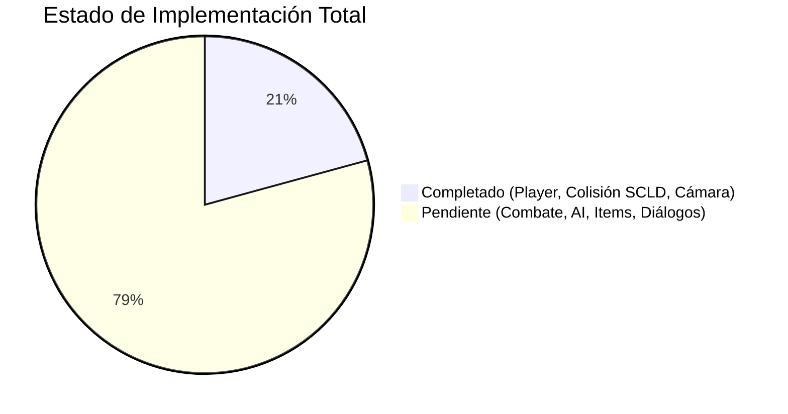

# 📋 Inventario Técnico y Kanban Maestro: Tomba2Engine ➔ Bevy (Rust)

> **Regla de oro del proyecto:** Este inventario mapea **función por función, estado por estado y mecanismo por mecanismo** el motor C++ (`Tomba2Engine/`) y sus direcciones de oráculo de PS1 contra la arquitectura ECS en Rust (`bevy_tomba2/`).

---

## 🧭 Resumen de Cobertura por Sectores

---

## 🗂️ SECTOR 1: Player Core & Locomotion (`game/player/actor_tomba.cpp`, `actor_tomba.h`, `tomba_state.h`)

Gestiona el ciclo de vida de Tomba, cinemática, integración de velocidades, gravedad, estados de locomoción y transiciones.

| ID | Función / Símbolo C++ | Oráculo / Dirección PS1 | Mecanismo y Comportamiento Técnico | Mapeo Bevy (Rust) | Estado |
| :--- | :--- | :--- | :--- | :--- | :---: |
| **P-01** | `ActorTomba::velocityIntegrate` | `0x80056B48` | Integración cinemática continua de posición X/Z/Y con `dirX*speed`, `dirZ*speed` y `dirY*speed`. | `player::tomba_movement_system` | `[x]` |
| **P-02** | `ActorTomba::settleStep` | `0x80054650` | Sonda de dos direcciones al suelo (`FUN_8004954C`), fija flags de contacto `G+0x60=1` y `G+0x5F`. | `player::tomba_movement_system` | `[x]` |
| **P-03** | `Entity_State_Jump` / `Jump2` | `0x80064524` / `0x800572EC` | Impulso de salto $12.0\text{ m/s}$ (`0xd800`), gravedad de ascenso $30.375\text{ m/s}^2$ (`0x360`), ápice de $2.37\text{ m}$. | `player::TOMBA_JUMP_SPEED`, `TOMBA_JUMP_GRAVITY` | `[x]` |
| **P-04** | `Entity_ApplyGravity` / `VelocityMax` | `0x80066478` / `0x80066538` | Gravedad de descenso $36.0\text{ m/s}^2$ (`0x400`), cap terminal $12.0\text{ m/s}$ (`0x2800`), contacto de suelo. | `player::TOMBA_GRAVITY`, `TOMBA_TERMINAL_VELOCITY` | `[x]` |
| **P-05** | `ActorTomba::turnBiasCompute` | `0x80055C9C` | Cálculo de sesgo de giro según heading de cámara (3072 referencia, threshold 0x800). | `player::tomba_movement_system` (facing) | `[x]` |
| **P-06** | `Math_ApproachAngle_2` (Junction) | `0x800637F4` | Interpolación de ángulo de encarado en bifurcaciones a 0x100 unidades/tick (11.78 rad/s). | `player::PlayerActionState::TurnToJunction` | `[x]` |
| **P-07** | `Entity_Update` (Speed Table) | `0x800A4710` | Aceleración progresiva analógica de caminata a carrera (16 a 32 PS1 units/tick, 4.80 a 9.60 m/s). | `player::tomba_movement_system` (Run threshold) | `[ ]` |
| **P-08** | `ActorTomba::interactWalk` | `0x80022760` | Recorrido de lista auxiliar `*0x1F800154` para despacho de colisión con ítems/switches. | `interaction::player_interact_system` | `[ ]` |
| **P-09** | `ActorTomba::postInteractWalk` | `0x801130C4` | Despacho secundario por tipo de ítem (tipos 3, 7, 8, 0xF, 0x14, 0x2F, 0x56). | `interaction::player_interact_system` | `[ ]` |
| **P-10** | `ActorTomba::growthStep` | `0x80057DC0` | Latch de crecimiento de Tomba (`G+0x17E` bit 0x8000), escalado de offset físico `physOffsetY`. | `player::TombaGrowth` component | `[ ]` |
| **P-11** | `ActorTomba::growthYSnap` | `0x80022C78` | Snapping vertical en transición de tamaño pequeño/grande sin hundirse en el suelo. | `player::growth_snap_system` | `[ ]` |
| **P-12** | `ActorTomba::postFrameWaterCheck` | `0x8010E904` | Comprobación de superficie de agua en nivel costero (`0x800BF816`), flotación y nado. | `player::PlayerActionState::Swim` | `[ ]` |
| **P-13** | `ActorTomba::outerTransitionGate` | `0x80053E50` | Puerta de transición exterior entre estados activos (`outerState` 0 a 7, reset de walk). | `player::PlayerStateMachine` | `[ ]` |
| **P-14** | `ActorTomba::outerTransitionCommit` | `0x80053FDC` | Compromiso de nuevo objetivo de giro (`settleCounter=0x5A`), sincronización de animación. | `player::PlayerStateMachine` | `[ ]` |

---

## 🗂️ SECTOR 2: Terrain Collision & Rail Grid (`game/player/collision.cpp`, `collision.h`)

Encargado de la geometría 2.5D, rieles SCLD, proyección ortogonal y muestreo de suelos.

| ID | Función / Símbolo C++ | Oráculo / Dirección PS1 | Mecanismo y Comportamiento Técnico | Mapeo Bevy (Rust) | Estado |
| :--- | :--- | :--- | :--- | :--- | :---: |
| **C-01** | `Collision::snapObjectToTerrain` | `0x8004766C` | Sonda sobre celda SCLD, proyección horizontal X/Z en sector, latch `GR_BEST_LINE`. | `collision::CollisionPlane::project_actor_onto_plane` | `[x]` |
| **C-02** | `f_ProjectActorOntoAreaPlane` | `0x80047778` | Proyección ortogonal con eje dominante (Z-dominant si $dx < dz$, X-dominant si $dx \ge dz$). | `collision::CollisionPlane::project_actor_onto_plane` | `[x]` |
| **C-03** | `Collision::floorPick` | `0x80048034` | Selección de línea de suelo estrictamente inferior al probe; `None` si está en el aire. | `collision::CollisionPlane::sample_floor` | `[x]` |
| **C-04** | `Collision::isWallBlocking` | `0x80048750` | Bloqueo horizontal por máscaras de pared: `kind & 0x04` (+s forward) y `kind & 0x08` (-s backward). | `collision::CollisionPlane::is_wall_blocking` | `[x]` |
| **C-05** | `Collision::checkJunction` | `0x800490E4` | Detección de bifurcación dentro de media celda SCLD ($0.32\text{ m}$) y ventana vertical ($0.64\text{ m}$). | `collision::LevelCollision::check_junction` | `[x]` |
| **C-06** | `Collision::gridSetup` | `0x80049968` | Configuración de punteros de fila de celda en scratchpad (`0x1F8001CC..DC`) por sector. | `collision::LevelCollision::planes` | `[x]` |
| **C-07** | `Collision::gridQuery` | `0x80047CBC` | Recorrido de vecindad de celdas según coordenadas de la sonda. | `collision::LevelCollision` indexing | `[x]` |
| **C-08** | `Collision::listScan` | `0x80031780` | Recorrido de lista enlazada de obstáculos de 8 bytes con terminador bit30/bit31. | `collision::ObstacleList` resource | `[ ]` |
| **C-09** | `Collision::flatNormal` | `0x80048750` | Cálculo de vector normal de superficie inclinada (`ratan2/sqrt`) para ajustar inclinación. | `collision::CollisionPlane::normal_at` | `[ ]` |

---

## 🗂️ SECTOR 3: Actor-Object & Entity Collision (`game/world/collision_resolve.cpp`, `collision_resolve.h`)

Resuelve las colisiones tridimensionales entre Tomba y otras entidades (cajas, enemigos, plataformas flotantes).

| ID | Función / Símbolo C++ | Oráculo / Dirección PS1 | Mecanismo y Comportamiento Técnico | Mapeo Bevy (Rust) | Estado |
| :--- | :--- | :--- | :--- | :--- | :---: |
| **W-01** | `CollisionResolve::cylinderResolve` | `0x80023D48` | Intersección cilíndrica actor vs entidad con radios $R_1 + R_2$, empuje XZ y test de altura Y. | `collision::cylinder_resolve_system` | `[ ]` |
| **W-02** | `CollisionResolve::landOnObjectTop` | `0x80023F10` | Detección de aterrizaje sobre la cabeza/tope de un objeto (caja, barril, lomo de enemigo). | `collision::land_on_object_system` | `[ ]` |
| **W-03** | `CollisionResolve::classifyBodyContact` | `0x80024108` | Clasificación de contacto: lateral (bloqueo/empuje), superior (apoyo), inferior (techo). | `collision::ContactClassification` | `[ ]` |
| **W-04** | `CollisionResolve::resolveByContactPolicy` | `0x80024250` | Aplicación de políticas por tipo de entidad: daño, rebote, recogida o desplazamiento. | `collision::contact_policy_system` | `[ ]` |

---

## 🗂️ SECTOR 4: 2.5D Rail Camera Pipeline (`game/camera/cutscene_camera.cpp`, `camera_look_builder.cpp`)

Implementa la cámara en rieles de Tomba 2, seguimiento suave por ejes, clamp a suelo y cinemáticas.

| ID | Función / Símbolo C++ | Oráculo / Dirección PS1 | Mecanismo y Comportamiento Técnico | Mapeo Bevy (Rust) | Estado |
| :--- | :--- | :--- | :--- | :--- | :---: |
| **CAM-01** | `CutsceneCamera::followAxis` | `0x8006D960` | Filtro paso bajo de seguimiento continuo ($\alpha = 1 - 0.875^{\text{ticks}}$), sin saltos abruptos. | `camera::follow_axis` | `[x]` |
| **CAM-02** | `CutsceneCamera::trackXZ` | `0x8006D960` | Seguimiento en plano horizontal X/Z limitado por `CAM_MAX_STEP_XZ` ($61.44\text{ m/s}$). | `camera::camera_controller` | `[x]` |
| **CAM-03** | `CutsceneCamera::trackY` | `0x8006DA54` | Seguimiento vertical Y con zona muerta ($1.40\text{ m}$ a $5.80\text{ m}$) para no saltar con Tomba. | `camera::camera_controller` | `[x]` |
| **CAM-04** | `CutsceneCamera::yFloor` | `0x8006C80C` | Límite inferior absoluto de altura de cámara por área ($5.50\text{ m}$ en Fisherman's Village). | `camera::CAM_FOLLOW_HEIGHT` | `[x]` |
| **CAM-05** | `LookAngleBuilder::distSolve` | `0x8006CF10` | Distancia base de cámara según curvatura del sector ($14.0\text{ m}$ base). | `camera::CAM_FOLLOW_DISTANCE` | `[x]` |
| **CAM-06** | `LookAngleBuilder::headingSolve` | `0x8006DCF4` | Orientación hacia la normal del riel $N = (-dir_z, dir_x)$ con suavizado de cruces. | `camera::camera_controller` (target_normal) | `[x]` |
| **CAM-07** | `CutsceneCamera::shakeTail` | `0x8006C988` | Máquina de estados de sacudida sísmica de pantalla por terremotos o impactos. | `camera::CameraShake` component/system | `[ ]` |
| **CAM-08** | `CutsceneCamera::pitchFollow` | `0x8006E360` | Modo de cámara 3: cabeceo vertical dinámico al mirar pendientes o abismos. | `camera::pitch_follow_system` | `[ ]` |

---

## 🗂️ SECTOR 5: Skeletal Animation VM (`game/object/animation.cpp`, `animation.h`)

Controla el despacho de clips esqueléticos ANMP, tiempos de tick, transiciones y poses sostenidas.

| ID | Función / Símbolo C++ | Oráculo / Dirección PS1 | Mecanismo y Comportamiento Técnico | Mapeo Bevy (Rust) | Estado |
| :--- | :--- | :--- | :--- | :--- | :---: |
| **AN-01** | `Animation::attach` | `0x80077C40` | Asociación de tabla de animación esquelética y clip inicial a la entidad. | `player::hook_tomba_animation_player` | `[x]` |
| **AN-02** | `Animation::step` | `0x80076D68` | Máquina de ejecución de ticks por frame; reproduce una vez o en bucle según tag. | `player::tomba_animation_control_system` | `[x]` |
| **AN-03** | `CurrentAnimation` Latch | `ActorTomba` state | Solo disparar `transitions.play()` al cambiar de estado; no reiniciar en cada frame. | `player::CurrentAnimation` component | `[x]` |
| **AN-04** | `Locomotion Clip Mapping` | Banco ANMP (239) | Mapeo canónico: #2 (Idle), #4 (Walk), #12 (Run), #20 (Jump Rise), #202 (Jump Fall). | `player::TombaAnimationAssets` | `[x]` |
| **AN-05** | `Animation::advanceLinkChain` | `0x80077B5C` | Cadenas de animación compuestas: intro de salto $\to$ planeo $\to$ aterrizaje. | `animation::AnimationChain` system | `[ ]` |
| **AN-06** | `Animation::applyFrame` | `0x80077890` | Aplicación de escala y rotación por hueso respetando la jerarquía original. | `animation::bone_transform_system` | `[ ]` |

---

## 🗂️ SECTOR 6: Interaction & Targeting (`game/player/actor_interaction.cpp`, `actor_targeting.cpp`)

Detecta objetos interactivos del entorno (cofres, palancas, NPCs) y alinea a Tomba.

| ID | Función / Símbolo C++ | Oráculo / Dirección PS1 | Mecanismo y Comportamiento Técnico | Mapeo Bevy (Rust) | Estado |
| :--- | :--- | :--- | :--- | :--- | :---: |
| **INT-01** | `ActorInteraction::proximityCheck` | `0x80022060` | Prueba de cercanía cilíndrica/radial para ítems tipo 0/1/2/3/7. | `interaction::proximity_check_system` | `[ ]` |
| **INT-02** | `ActorInteraction::type8Interact` | `0x800205CC` | Interacción tipo 8: empuje o rotación automática de Tomba frente al mecanismo. | `interaction::push_lever_system` | `[ ]` |
| **INT-03** | `ActorInteraction::type7Interact` | `0x800235A0` | Interacción tipo 7: activación de switches de suelo y placas de presión. | `interaction::pressure_plate_system` | `[ ]` |
| **INT-04** | `ActorTargeting::tryAcquireTarget` | `0x8001FAE0` | Selección del objetivo más cercano en cono de visión para fijar ataques. | `targeting::target_acquire_system` | `[ ]` |

---

## 🗂️ SECTOR 7: Inventory & Item Management (`game/items/inventory.cpp`, `item_grant.cpp`)

Controla el inventario de 256 objetos, equipamiento activo y asignación por misiones.

| ID | Función / Símbolo C++ | Oráculo / Dirección PS1 | Mecanismo y Comportamiento Técnico | Mapeo Bevy (Rust) | Estado |
| :--- | :--- | :--- | :--- | :--- | :---: |
| **ITM-01** | `Inventory::count` / `has` | `0x800BF870` | Consulta de cantidad disponible (0 a 99) y posesión de un ítem por ID. | `items::Inventory::has_item` | `[ ]` |
| **ITM-02** | `Inventory::add` | `0x8004D338` | Añadir cantidad a slot de ítem respetando límite de 99. | `items::Inventory::add_item` | `[ ]` |
| **ITM-03** | `Inventory::giveAndFlag` | `0x8004D4C4` | Concesión de ítem clave + emisión automática de flag de misión (`scene_flags`). | `items::Inventory::give_and_flag` | `[ ]` |
| **ITM-04** | `ItemGrant::all` | `0x8004D550` | Modo depuración: otorgar todos los ítems del juego al inventario. | `items::debug_grant_all` | `[ ]` |

---

## 🗂️ SECTOR 8: Combat & Enemy AI (`game/ai/actor_zoned_attacker.cpp`, `actor_object_contact.cpp`)

Comportamiento de los cerdos Koma, mecánicas de montura, mordisco y lanzamiento parabólico.

| ID | Función / Símbolo C++ | Oráculo / Dirección PS1 | Mecanismo y Comportamiento Técnico | Mapeo Bevy (Rust) | Estado |
| :--- | :--- | :--- | :--- | :--- | :---: |
| **AI-01** | `ActorZonedAttacker::idleTick` | `0x8002B410` | Patrullaje de cerdo común en sector de riel delimitado por balizas. | `ai::pig_patrol_system` | `[ ]` |
| **AI-02** | `ActorZonedAttacker::approachAndFace` | `0x8002B540` | Detección de Tomba por proximidad, giro y carrera de embestida. | `ai::pig_chase_system` | `[ ]` |
| **AI-03** | `ActorObjectContact::resolveHitOrProximity` | `0x80024A10` | Colisión de Tomba sobre el lomo del cerdo: inicio de estado montado / mordisco. | `combat::pig_mount_system` | `[ ]` |
| **AI-04** | `Entity_State_Throw` | `0x80067CA4` (st 2) | Giro centrífugo de Tomba con el cerdo en la boca y lanzamiento parabólico. | `combat::player_throw_system` | `[ ]` |
| **AI-05** | `ActorBump::respondToContact` | `0x80025110` | Reacción de retroceso por choque (`recoilTimer`), aturdimiento y parpadeo. | `combat::damage_recoil_system` | `[ ]` |

---

## 🗂️ SECTOR 9: Event Flags & Progression Engine (`game/scene/scene_flags.cpp`, `area_fade_sequencer.cpp`)

Motor de progresión: tabla de 256 flags que controlan las 137 misiones del juego y fundidos de pantalla.

| ID | Función / Símbolo C++ | Oráculo / Dirección PS1 | Mecanismo y Comportamiento Técnico | Mapeo Bevy (Rust) | Estado |
| :--- | :--- | :--- | :--- | :--- | :---: |
| **SC-01** | `SceneFlags::get` / `set` | `0x800BF800` | Lectura y escritura de bits en el vector maestro de 256 flags (`kFlagTable`). | `scene::EventFlags` resource | `[ ]` |
| **SC-02** | `AreaFadeSequencer::step` | `0x80031890` | Fundido a negro (fade out) y apertura (fade in) en transiciones de área. | `scene::fade_transition_system` | `[ ]` |
| **SC-03** | `CardLoadMachine::step` | `0x80032010` | Carga de títulos de eventos y tarjetas gráficas en pantalla. | `scene::event_card_system` | `[ ]` |

---

## 🗂️ SECTOR 10: Dialog & 9-Slice UI (`game/ui/dialog_text_stream.cpp`, `font.cpp`)

Renderizado de textos, cajas de diálogo flotantes con estilo retro y selección de opciones.

| ID | Función / Símbolo C++ | Oráculo / Dirección PS1 | Mecanismo y Comportamiento Técnico | Mapeo Bevy (Rust) | Estado |
| :--- | :--- | :--- | :--- | :--- | :---: |
| **UI-01** | `DialogTextStream::step` | `0x8007C0D0` | Flujo carácter a carácter según velocidad de texto (`DAT_800BF8A3`). | `ui::dialog_typewriter_system` | `[ ]` |
| **UI-02** | `DialogBackdrop::render` | `0x8007D210` | Generación de caja de diálogo 9-slice con bordes redondeados originales. | `ui::dialog_box_render_system` | `[ ]` |
| **UI-03** | `Font::glyphMetrics` | `0x8007DF40` | Mapeo de ancho variable por carácter usando la textura tipográfica de PS1. | `ui::font_metrics` | `[ ]` |

---

## 🗂️ SECTOR 11: Audio Coordination & Sound Dispatch (`game/audio/music_coord.cpp`, `audio_dispatch.cpp`)

Coordinación de música BGM por CD-XA y mezclador de efectos sonoros por eventos.

| ID | Función / Símbolo C++ | Oráculo / Dirección PS1 | Mecanismo y Comportamiento Técnico | Mapeo Bevy (Rust) | Estado |
| :--- | :--- | :--- | :--- | :--- | :---: |
| **AUD-01** | `MusicCoord::fieldBgmDirector` | `0x80074F24` | Selección de pista XA por área (p. ej. Track 04_01 en Fisherman's Village) con bucle. | `audio::bgm_player_system` | `[x]` |
| **AUD-02** | `MusicCoord::cutIfDialog` | `0x80075024` | Atenuación / fade-out de música durante diálogos importantes. | `audio::bgm_dialog_duck_system` | `[ ]` |
| **AUD-03** | `AudioDispatch::dispatch3Way` | `0x80074590` | Disparo de SFX por ID con asignación de canal libre (p. ej. SFX #25 salto de héroe). | `audio::play_sfx` helper | `[x]` |
| **AUD-04** | `AudioDispatch::voiceMixTick` | `0x80075CEC` | Curva de ganancia y desvanecimiento de volumen maestro. | `audio::volume_master_system` | `[ ]` |
